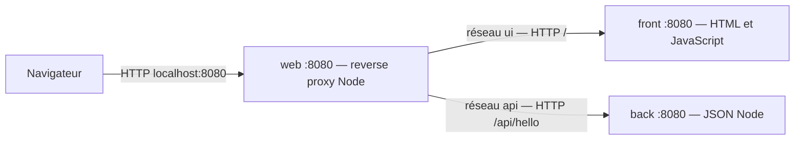

# Carnet de chantier — Docker Cloud en JavaScript

Trois images personnalisées : **front** (page HTML et JavaScript), **back** (API JSON) et **web** (reverse proxy). Les trois serveurs sont écrits en JavaScript et exécutés par Node.js. Aucun téléchargement depuis Docker Hub.

## Lancement

Prérequis : Docker démarré, Compose v2 récent et accès au registre `cgr.dev`. Aucun Node installé sur l’hôte n’est nécessaire.

```sh
cp .env.example .env
docker compose config --quiet
docker compose up --build -d --wait
```

Ouvrir http://localhost:8080 pour créer, modifier et supprimer les notes. `HTTP_PORT` et `MAX_NOTES` sont personnalisables dans `.env`. Relancer `docker compose up -d` après une modification.

```sh
curl -f http://localhost:8080/api/hello
docker compose ps
docker compose stats --no-stream
docker compose logs
docker compose down
```

## Architecture et communications



Voir aussi `docs/architecture.svg`. Le DNS Docker résout `front` et `back`. Ces services sont sur deux réseaux internes distincts et ne publient aucun port hôte. Web est sur les deux réseaux ainsi que `edge`. Seul web publie son port, sur 127.0.0.1 pour un accès local. Le JavaScript appelle `/api/hello` sur la même origine : aucun réglage CORS nécessaire. Le front ne contacte pas directement le back ; sa dépendance au back est une décision d’orchestration pour rendre la démonstration disponible dans l’ordre back → front → web.

## Images et dépendances au build

La base `cgr.dev/chainguard/node:latest` vient du **registre Chainguard**, sans Docker Hub. Son digest est figé dans chaque Dockerfile : `sha256:1ae8ed719c65888716078a52ce2166767e091f0b1072a79f6b42becba6e1ad44`. Chaque image ajoute le code du service concerné et ses paramètres de lancement. Les noms locaux `docker-cloud-*:1.0` peuvent apparaître avec le préfixe normalisé `docker.io/library` dans les logs : cela nomme des images locales, sans téléchargement ou publication sur Docker Hub.

Node interprète les sources : pas de compilation ni de multi-stage. La base contient Node, le moteur V8 et leurs bibliothèques système. Une base vide scratch ne suffirait pas pour exécuter ces scripts. Aucun `apt`, `apk`, `npm install`, script distant ou mise à jour OS n’est exécuté dans nos Dockerfiles.

| Dépendance | Utilisation |
|---|---|
| Node.js et bibliothèques système de la base | Exécution des programmes JavaScript |
| `node:http` intégré | Serveurs, proxy et contrôle de santé |
| `node:fs`, `node:path` intégrés | Lecture du HTML par le front |

Aucun module tiers npm n’est nécessaire. Les scripts CommonJS sont lancés directement, sans `package.json`. Les communications sont en HTTP interne ; pas de certificat personnalisé à installer. La construction initiale nécessite le réseau pour la base, sans accès à npm.

## Manipulations de l’environnement et entrypoints

| Instruction | Explication |
|---|---|
| `WORKDIR /app` | Définit le répertoire de copie et d’exécution |
| `ENV NODE_ENV=production` | Indique le contexte de déploiement ; notre code ne dépend pas de sa valeur |
| `COPY --chown=65532:65532` | Copie le service et les scripts partagés, avec le propriétaire non root |
| `USER 65532:65532` | Exécute Node sans privilèges root |
| `EXPOSE 8080` | Documente le port interne sans le publier |
| `STOPSIGNAL SIGTERM` | Définit le signal d’arrêt normal |
| `ENTRYPOINT ["/usr/bin/node"]` | Forme exec : Node est PID 1, reçoit directement les signaux |
| `CMD` | Options Node, chemin du script et argument de port par défaut |

Aucun processus enfant n’est lancé, donc aucun init ni shell intermédiaire n’est requis. Le back écrit uniquement dans le volume `/data` ; le reste du système de fichiers reste en lecture seule. Le port 8080 est non privilégié. Les logs utilisent stdout et stderr.

## Arguments au run et traduction Compose

Les options Node précèdent le nom du script. Les arguments applicatifs le suivent. `command` remplace `CMD`, en conservant l’entrypoint.

| Option ou variable | Effet / traduction Compose |
|---|---|
| `--max-old-space-size=N` | Limite de la vieille génération du tas V8 en Mio : front 40, back 64, web 96, dans `command` |
| `--v8-pool-size=1` | Pool de threads auxiliaires V8 ; ne plafonne ni tous les threads ni le temps CPU, dans `command` |
| `front/server.js`, `back/server.js`, `web/server.js` | Programme propre à chaque service, dans `command` |
| `--port=8080` | Port applicatif validé par le script partagé, dans `command` |
| `NOTES_FILE`, `MAX_NOTES` | Fichier de sauvegarde et nombre maximal de notes, `environment` du back |
| `FRONT_URL`, `BACK_URL` | Destinations HTTP, `environment` du web |
| `HTTP_PORT` | Interpolation Compose du port hôte, pas une variable Node |

Le programme rejette les ports invalides et les arguments inconnus. Le proxy refuse les URLs amont absentes, mal formées ou non HTTP.

Exemple de run du front après build :

```sh
docker run --rm --name front-demo --memory=128m --cpus=0.25 --pids-limit=64 --read-only --cap-drop=ALL --security-opt=no-new-privileges:true -p 127.0.0.1:8081:8080 docker-cloud-front:1.0 --max-old-space-size=40 --v8-pool-size=1 front/server.js --port=8080
```

## Orchestration et ressources

| Service | Plafond RAM Docker | Plafond CPU | Old space V8 | Raison |
|---|---:|---:|---:|---|
| front | 128 Mio | 0,25 CPU | 40 Mio | Petite page, marge pour Node et la sonde |
| back | 128 Mio | 0,50 CPU | 64 Mio | JSON, runtime et sonde |
| web | 192 Mio | 0,50 CPU | 96 Mio | Proxy et buffers HTTP |

`mem_limit` borne toute la mémoire du conteneur, y compris la sonde. Un dépassement peut provoquer un OOM kill. L’old space V8 est seulement une partie de la mémoire Node : jeune génération, buffers, piles et bibliothèques natives consomment aussi de la RAM. Les plafonds laissent donc une marge. `cpus` limite le temps CPU, sans réserver de cœur. `pids_limit: 64` limite les tâches Linux, dont les threads. Ces réglages conviennent à une démonstration ; une charge réelle demanderait des mesures.

`depends_on` avec `service_healthy` attend back avant front, puis les deux avant web. `shared/healthcheck.js` lance Node et appelle `/healthz` sur localhost : sortie 0 si HTTP 200, sinon 1. Aucun curl ni shell n’est utilisé dans les images. Sonde toutes les 5 s, timeout Compose 3 s, timeout HTTP 2 s, 5 tentatives, période initiale 5 s. La sonde web indique sa disponibilité locale, sans tester les amonts.

Les dépendances contrôlent le démarrage, pas une supervision continue. Si un amont tombe, web renvoie 502 ; les requêtes amont ont un timeout de 5 s. `restart: unless-stopped` relance un processus arrêté, pas un conteneur simplement unhealthy. `read_only`, `cap_drop: [ALL]` et `no-new-privileges` réduisent les privilèges. Le volume `notes-data` conserve les notes. Cette démonstration locale ne fournit pas de comptes ni de terminaison TLS.

## SIGTERM et arrêt propre

`shared/server.js` écoute SIGTERM et SIGINT, puis appelle `server.close` pour arrêter les nouvelles connexions et attendre les requêtes en cours. Après 8 s, il force leur fermeture et sort avec code 1. Un arrêt normal produit « Arrêt terminé » et un code 0. `stop_grace_period: 12s` laisse une marge avant SIGKILL. Compose arrête les dépendants avant les dépendances. Un SIGKILL ou un OOM ne peut pas être intercepté.

```sh
docker compose stop
docker compose logs --tail=20
docker compose ps -a
```

## Validation et images livrées

`sh scripts/smoke.sh` construit, attend la santé des trois services, vérifie front et API à travers web, les plafonds RAM/CPU, puis les codes de sortie et logs de SIGTERM. Le test utilise curl et Python 3 sur l’hôte ; les applications restent entièrement en JavaScript. Il laisse les conteneurs arrêtés. Voir `docs/validation.md` pour les résultats réellement obtenus.

```sh
sh scripts/smoke.sh
docker compose up -d
```

L’archive `../docker-cloud-images.tar` contient les images exportées de la plateforme de construction. Reconstruire sur une autre architecture si nécessaire.

```sh
docker load -i ../docker-cloud-images.tar
# Pour régénérer :
docker save -o ../docker-cloud-images.tar docker-cloud-front:1.0 docker-cloud-back:1.0 docker-cloud-web:1.0
```

## Remise Git

Créer un dépôt dans ce dossier puis publier sur votre compte :

```sh
git init
git add .
git commit -m "Projet Docker Cloud en JavaScript"
# Créer le dépôt distant puis indiquer son URL réelle :
git remote add origin URL_DU_DEPOT
git push -u origin HEAD
```

Le dépôt distant reste à créer. Le rendu doit contenir les sources, Dockerfiles, Compose, documentation et schéma avant la date fixée par le cours. Ne pas committer `.env` ni les archives d’images ; ils sont exclus dans `.gitignore`.

## Docker et virtualisation historique

Une VM embarque un OS invité et son noyau. Les conteneurs Linux partagent le noyau de l’hôte Linux : namespaces pour isoler les processus, cgroups pour leurs ressources. Ils démarrent généralement plus vite et évitent un OS invité complet par application. Dockerfiles et Compose rendent la préparation, les dépendances et les communications traçables. Le partage du noyau constitue une frontière d’isolation différente d’une VM. Sur macOS, Docker Desktop fournit une VM Linux. ARM et x86 nécessitent des images adaptées ou une émulation.

## Correspondance avec le barème

| Critère | Preuve |
|---|---|
| Mise en forme | README, fichiers et dossiers des trois services |
| Dépendances / manipulations OS | Tableaux build et environnement, Dockerfiles |
| Arguments / entrypoints | Tableau run, `ENTRYPOINT`, `CMD`, `command` |
| Traduction Compose | Arguments Node, `environment`, `ports` |
| Limites de ressources | Tableau RAM/CPU et paramètres Compose |
| SIGTERM | Module partagé et test d’arrêt |
| Ordre de démarrage | `depends_on` et `service_healthy` |
| Communications | Mermaid, SVG et réseaux internes |

## Sources

- [Image Node Chainguard](https://images.chainguard.dev/directory/image/node/overview)
- [Options Node et mémoire V8](https://nodejs.org/api/cli.html)
- [Ordre de démarrage Compose](https://docs.docker.com/compose/how-tos/startup-order/)
- [Paramètres des services Compose](https://docs.docker.com/reference/compose-file/services/)


## Application de notes de chantier

Interface adaptée au mobile : chantier, zone, description et statut (« À faire », « En cours », « Terminé »). L’utilisateur peut créer, modifier, supprimer et filtrer les notes. Les dates de création et de modification sont enregistrées. Les textes sont affichés avec `textContent`, sans interpréter le HTML fourni par un utilisateur.

| Route | Action |
|---|---|
| `GET /api/notes` | Liste des notes |
| `POST /api/notes` | Création, HTTP 201 |
| `PUT /api/notes/:id` | Modification complète |
| `DELETE /api/notes/:id` | Suppression, HTTP 204 |

Chantier et zone : 1 à 100 caractères ; description : 1 à 2000. Le back vérifie les statuts, limite le corps JSON à 16 Kio et refuse les requêtes invalides. `MAX_NOTES` vaut 1000 par défaut. Les IDs sont des UUID générés par `node:crypto`. `node:fs` et `node:path` sont également utilisés par le back pour le stockage ; aucune dépendance npm ajoutée.

`NOTES_FILE=/data/notes.json` désigne le fichier dans le volume nommé `notes-data`. Le Dockerfile du back copie le dossier vide `back/data` avec le propriétaire 65532 ; Docker initialise ainsi les droits du volume neuf pour l’utilisateur non root, sans installation de paquet ni commande chown au run. Le montage du volume reste accessible en écriture malgré `read_only: true`.

Les sauvegardes passent par un fichier temporaire puis un renommage atomique. Les écritures synchrones sont sérialisées dans le processus Node ; les requêtes simultanées ne doivent pas écraser les créations précédentes. Cette conception cible une seule instance du back, sans partage du JSON entre plusieurs réplicas. Un JSON corrompu fait échouer le démarrage au lieu d’effacer les données. Pour sauvegarder les données, copier le volume à l’arrêt. `docker compose down` conserve les notes ; **`docker compose down -v` les supprime**.

### Test isolé de l’application

Ces commandes utilisent un projet et un port distincts de la démonstration et ne touchent pas ses notes. Le test attend un volume de test neuf. Ne supprimer un volume de test existant que si ses données sont jetables.

```sh
HTTP_PORT=18080 docker compose -p chantier-integration up --build -d --wait
HTTP_PORT=18080 python3 scripts/test-notes.py
# Arrêter les seuls conteneurs de test après vérification :
docker compose -p chantier-integration down
```

Le test vérifie CRUD, champs invalides, JSON invalide, taille excessive, créations concurrentes et persistance après suppression/recréation des conteneurs. `scripts/smoke.sh` vérifie en plus la santé, les plafonds de ressources et SIGTERM.
